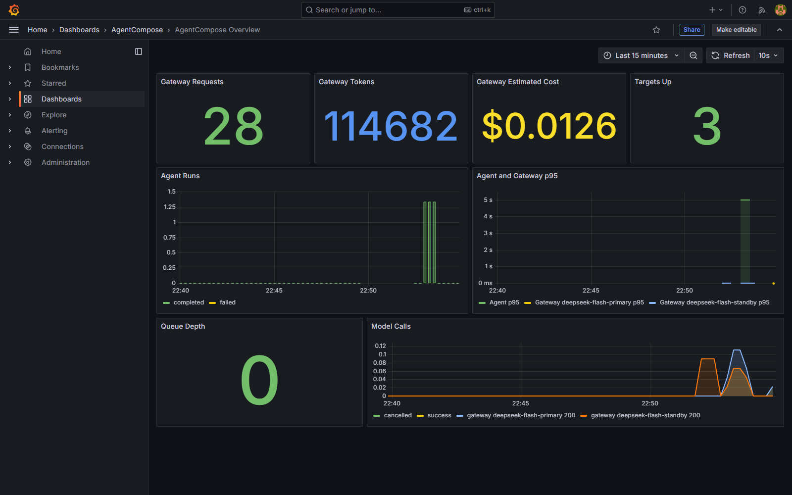
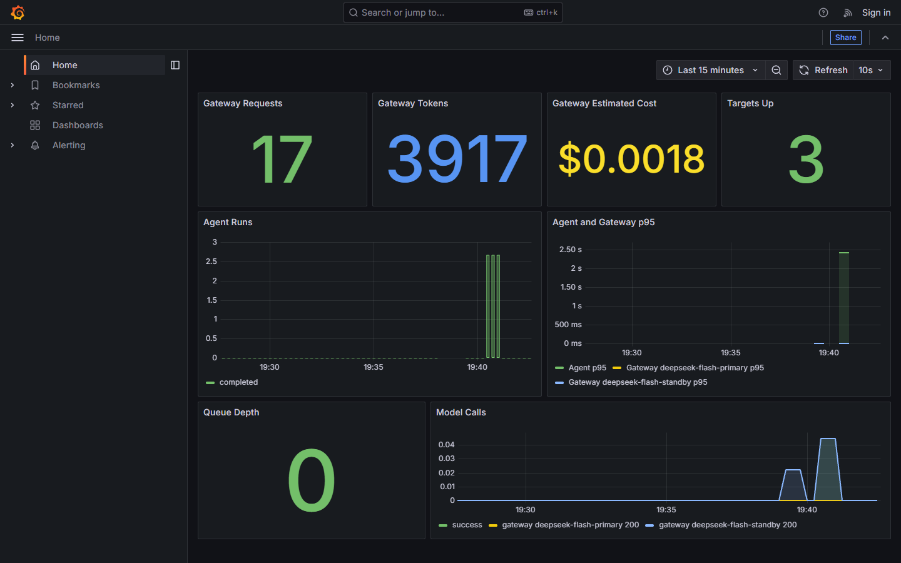
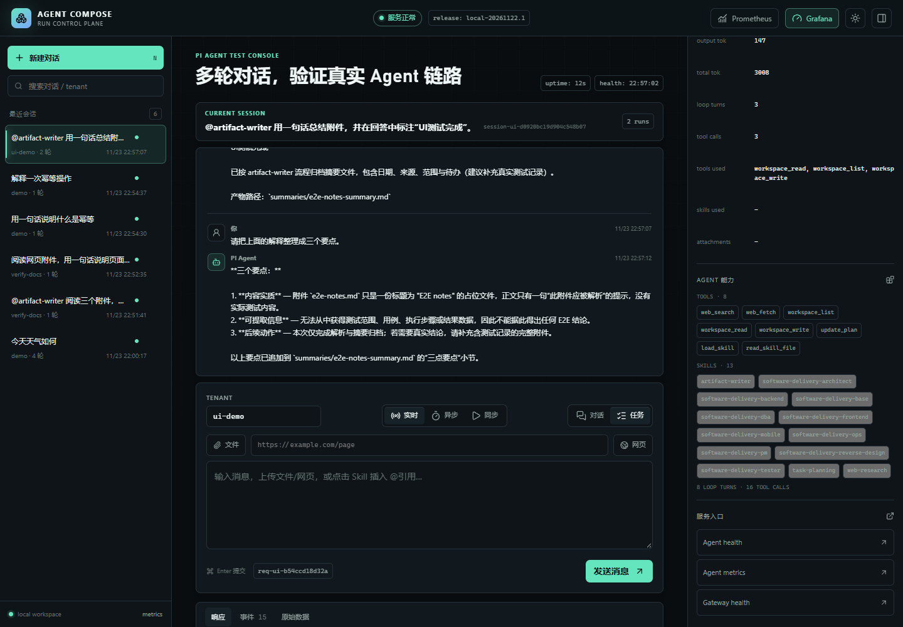
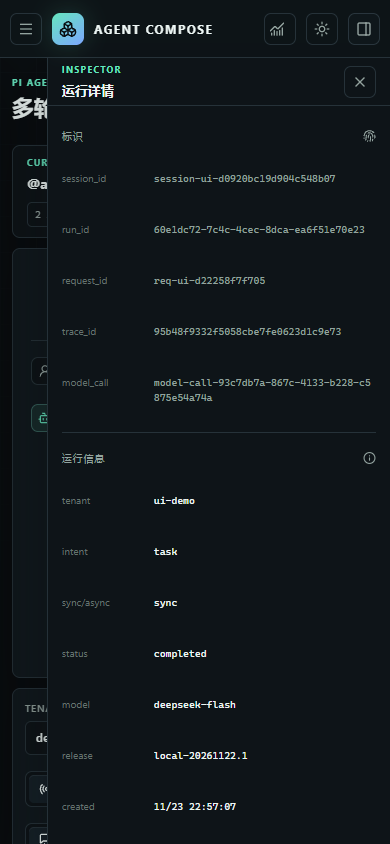
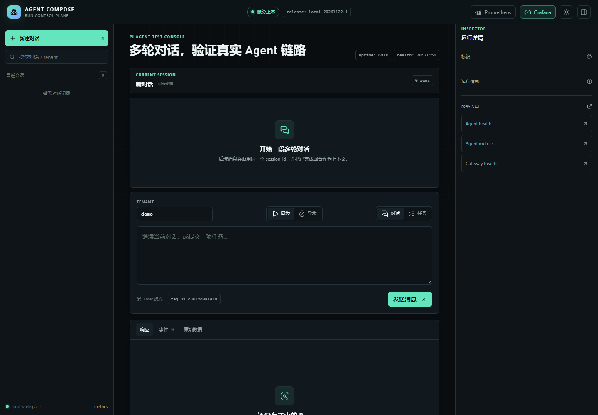

# AgentCompose 验收记录

> 验收日期：2026-11-23
>
> 验收环境：Windows、Docker 29.6.2、Docker Compose v5.3.1、Node.js 24.19.0
>
> 验收结论：✅ 通过

## 1. 四容器健康状态

| 服务 | 状态 | 宿主机端口 |
|---|---|---:|
| `gateway` | healthy | 4000 |
| `agent` | healthy | 8080 |
| `prometheus` | healthy | 9090 |
| `grafana` | healthy | 8765 |

证据：

- `check/evidence/compose-ps.txt`
- `check/evidence/compose-services.txt`

`docker compose config --services` 只输出四个服务。

## 2. 四个宿主机探针

| 探针 | 结果 |
|---|---|
| `GET http://127.0.0.1:4000/health/liveliness` | HTTP 200 |
| `GET http://127.0.0.1:8080/health` | HTTP 200，`status=ok` |
| `GET http://127.0.0.1:9090/-/healthy` | HTTP 200 |
| `GET http://127.0.0.1:8765/api/health` | HTTP 200，`database=ok` |

## 3. Prometheus targets

| Job | Target | 状态 |
|---|---|---|
| `gateway` | `gateway:4000` | UP |
| `agent` | `agent:8080` | UP |
| `prometheus` | `localhost:9090` | UP |

证据：

- `check/evidence/prometheus-targets.json`

## 4. Gateway 直连

请求逻辑模型 `deepseek-flash`：

- HTTP 请求成功。
- `finish_reason=stop`。
- 回答内容非空，长度 31 字符。
- 使用 `curl -L` 直读 `/metrics` 成功，返回 152577 字节。

## 5. Agent 同步运行

- Request ID：`req-acceptance-sync-001`
- Run ID：`dfe6ee09-f9bd-4811-aa6a-6948cbae5004`
- 终态：`completed`
- `output` 非空，长度 79 字符
- 总 Token：2181

## 6. Agent 异步运行

- Request ID：`req-acceptance-async-001`
- 初始状态：`202 queued`
- Run ID：`0a1742cd-9564-4e7b-a916-3552ca3344f6`
- 查询终态：`completed`
- `output` 非空，长度 2085 字符
- 总 Token：3507

## 7. 指标前后值

| 指标 | 请求前 | 同步请求后 | 5 分钟增量 |
|---|---:|---:|---:|
| `sum(litellm_proxy_total_requests_metric_total)` | 26 | 27 | Prometheus 27 |
| `sum(agent_runs_total)` | 4 | 5 | Prometheus 5 |

基线从当前进程 `/metrics` 读取；请求后先验证直接指标增长，再等待 Prometheus 抓到不低于该值的新样本，兼容重建后的计数器归零。

## 8. Grafana

- 数据源 UID：`agent-prometheus`
- Dashboard：`AgentCompose Overview`
- Dashboard UID：`agentcompose-overview`
- 面板数：8
- 告警规则：Gateway target down、Agent target down
- 根地址 `http://127.0.0.1:8765/` 默认打开该 Dashboard。
- 本地匿名 Viewer 只读访问通过，管理员密码仍用于登录和编辑。
- Dashboard 地址：
  `http://127.0.0.1:8765/d/agentcompose-overview/agentcompose-overview`

截图：



根地址匿名打开效果：



截图中可见：

- Gateway Requests 非零。
- Gateway Tokens 非零。
- Gateway Estimated Cost 非零。
- Targets Up = 3。
- Agent Runs 和模型调用曲线有数据。

### 8.1 Agent Workbench

- 地址：`http://127.0.0.1:8080/ui/`
- 桌面布局：最近会话、多轮对话与运行详情、Inspector 三栏。
- 移动布局：会话列表和 Inspector 使用抽屉。
- 真实 UI 多轮会话：同一 `session_id` 连续 2 轮，均 `completed`。
- 第二轮使用任务模式，响应非空。
- 事件时间线：15 条事件。
- 首次运行通过 SSE 观察到流式输出。
- 首次运行上传 `e2e-notes.md`，并显式引用 `@artifact-writer`。
- 浏览器控制台错误：0。
- 桌面截图：`check/evidence/agent-ui.png`
- 移动截图：`check/evidence/agent-ui-mobile.png`
- E2E 摘要：`check/evidence/agent-ui-e2e.json`
- 会话 ID：`session-ui-d0920bc19d904c548b07`
- 会话删除：浏览器 E2E 已确认删除成功。

### 8.2 Agent Harness 扩展验证

- 联网研究 Run：`9e1ad4ab-7750-41ea-bbdc-ecb64f0a40ae`
- 状态：`completed`
- 循环轮数：6
- 工具调用：8
- 使用工具：`update_plan`、`web_search`、`web_fetch`
- 返回至少 3 个来源 URL。
- 文件交付 Run：`9581306a-93aa-4b49-8171-6b7ddc364984`
- 循环轮数：4
- 工具调用：3
- 使用工具：`load_skill`、`workspace_write`、`workspace_read`
- 使用 Skill：`artifact-writer`
- 实际产物：`/workspace/reports/deepseek-harness.md`
- `agent_tool_calls_total` 已产生 success 和 error 两类真实样本。
- 证据摘要：`check/evidence/agent-harness.json`

### 8.3 多格式输入与流式工作台

- Skills 总数：13，包含 EvalLab 的完整软件交付流水线。
- 多格式 Run：`fb7acba3-27f9-4c35-9ae7-dc03ab6807e1`
- 输入附件：`sample.docx`、`sample.pdf`、`notes.md`
- 抽取类型：DOCX、PDF、Markdown。
- 显式 Skill：`@artifact-writer`
- 状态：`completed`
- 网页附件 Run：`ebd80216-3340-4747-b11a-6c02c2212ea3`
- 网页来源：`https://example.com/`
- 抽取类型：`web`
- 工作台 E2E：上传附件、`@artifact-writer`、SSE token、桌面/移动布局均通过。





扩展验证前的发布态空工作台：



- 当时发布态 Agent Run 数：0。
- 发布清理脚本：`scripts/clear-agent-history.ps1`。

## 9. 测试和覆盖率

命令：

```powershell
cd agent
npm test
npm run test:coverage
```

结果：

- 测试总数：40
- 通过：40
- 失败：0
- 行覆盖率：84.08%
- 分支覆盖率：70.09%
- 函数覆盖率：86.40%

证据：

- `check/evidence/agent-test-coverage.txt`
- `check/evidence/agent-audit.json`

## 10. 依赖安全

`npm audit --omit=dev`：

```text
critical=0 high=0 moderate=0 low=0
```

PI 从课程快照 `0.87.1` 升级到 `1.6.0`，满足作业 `>=0.87.x`，并通过：

- TypeScript 编译。
- 本地 OpenAI-compatible 流式 Mock Gateway 测试。
- 真实 DeepSeek 经 LiteLLM 的 Agent 链路。

## 11. 重建复验

执行：

```powershell
docker compose down
docker compose up -d --build
```

结果：

- 命名卷保留。
- 四容器恢复 healthy。
- 四探针恢复 200。
- 三 targets 恢复 UP。
- Dashboard 自动加载。
- 同步和异步 Agent 请求再次成功。
- Gateway 和 Agent 指标继续产生新样本。

## 12. 安全与脱敏

- `.env` 未提交，内容未出现在验收输出。
- `DEEPSEEK_API_KEY` 仅注入 `gateway`。
- Agent 环境不含厂商密钥。
- Prometheus 未在配置文件中保存明文 token。
- Agent 最终镜像以 `node` 非 root 用户运行。
- 日志和 API 响应未输出 Authorization Header。
- README 和本文件只记录变量名、状态和指标值。

## 13. 工程优化

1. Agent 多阶段构建。
2. Agent 非 root 运行。
3. 依赖层缓存，源码变化不重复安装依赖。
4. 最终 Agent 镜像约 115 MB。
5. 镜像 digest、配置 SHA-256 写入 `release.json`。
6. PI 依赖安全升级，生产依赖 0 已知漏洞。

## 14. 遗留边界

- 当前是本地回环地址部署，不包含公网 TLS。
- `tenant` 是指标标签，不是完整身份授权系统。
- 未部署 Langfuse、Loki、Eval 平台或多副本。
- Grafana 告警已完成 provisioning 和规则加载，外部通知联系点未配置。
